# ALTARIS — Gestão de Coroinhas e Cerimoniários

MVP desenvolvido na disciplina **Projeto de Software** (ADS – Universidade Cruzeiro do Sul) para a
**Pastoral dos Coroinhas e Cerimoniários da Paróquia Imaculada Conceição Aparecida**
(Diocese de Santo André, São Bernardo do Campo – SP).

## Problema

A coordenação voluntária monta à mão, toda semana, a escala de cerca de 120 servidores do altar em
cinco comunidades (≈ 5 h/semana), com conflitos (o mesmo jovem em várias funções), sobrecarga de
poucos servidores e controle de túnicas sem transparência.

## O que o MVP faz

| Requisito | Funcionalidade |
|---|---|
| RF01 | Cadastro de servidores por comunidade, função, nível (experiente/em formação) e status |
| RF02 | Montagem da escala com lista sugerida **ordenada por quem serviu menos no mês** |
| RF03 | **Bloqueio de conflitos**: mesmo servidor em duas funções ou em horários sobrepostos |
| RF04 | Publicação da escala por **link público** (token aleatório, sem dados de contato) para o WhatsApp |
| RF05 | Túnicas e pagamentos com saldo calculado e fechamento de caixa conferível |

Alinhado ao **ODS 16 – Paz, Justiça e Instituições Eficazes** (metas 16.6 e 16.7).

## Tecnologias

Python 3.12 · Django 5.2 LTS (arquitetura MVT em camadas, com `services.py` para regras de negócio) ·
PostgreSQL 16 (SQLite no desenvolvimento) · Bootstrap 5 · Argon2 · pytest/pytest-django/pytest-cov ·
GitHub Actions (CI).

```
config/            configurações (variáveis de ambiente, segurança)
escala/models.py   entidades: Comunidade, Servidor, Celebracao, Atribuicao, Tunica, PagamentoTunica
escala/services.py regras de negócio (sugestão, conflitos, publicação, pagamentos)
escala/views.py    controle das requisições
escala/templates/  telas (mobile first, acessíveis)
escala/tests/      testes unitários e de integração
.github/workflows/ pipeline de integração contínua
```

## Como executar localmente

```bash
python -m venv .venv && source .venv/bin/activate   # Windows: .venv\Scripts\activate
pip install -r requirements-dev.txt
python manage.py migrate
python manage.py dados_demo --senha "uma-senha-forte"   # dados fictícios + usuário 'coordenacao'
python manage.py runserver
```

Acesse http://127.0.0.1:8000 e entre com o usuário `coordenacao`.

## Testes

```bash
pytest            # testes unitários + integração com relatório de cobertura
```

O pipeline de CI executa, a cada push e Pull Request: verificação de migrações, `check --deploy`,
`collectstatic` (build) e a suíte de testes no PostgreSQL, exigindo cobertura mínima de 85%.

## Segurança e acessibilidade

- Senhas com hash **Argon2id**; login obrigatório em todas as telas da coordenação; sessão com expiração.
- ORM com consultas parametrizadas, escape automático de HTML, CSRF, CSP e `X-Frame-Options: DENY`.
- Segredos somente em variáveis de ambiente (`.env.example`).
- Botões ≥ 44 px, alto contraste, alertas com **texto + símbolo + cor** e `role="alert"`.

## Implantação

Deploy por Blueprint no Render (`render.yaml`): web service Python (Gunicorn + WhiteNoise) e
PostgreSQL gerenciado, com deploy automático a cada merge na `main`.

- `SECRET_KEY` e o caminho do admin (`ADMIN_URL`) são gerados pelo Render; `DATABASE_URL` vem do banco.
- O domínio público (`RENDER_EXTERNAL_HOSTNAME`) é liberado automaticamente em `ALLOWED_HOSTS`/CSRF.
- `preparar_producao` (idempotente) cria as 5 comunidades e o usuário `coordenacao` com a senha
  definida em `ALTARIS_SENHA` no painel do Render; nenhuma senha fica no repositório.

### Monitoramento pós-lançamento

- **Health check** `GET /saude/` → `{"status":"ok","banco":"ok","latencia_ms":…,"versao":…}` (200) ou 503
  se o banco cair. Usado pelo Render (`healthCheckPath`) e por monitor externo de disponibilidade.
- **Logs** em stdout (acessos do Gunicorn, erros `django.request` e alertas `django.security`) na aba *Logs*.
- **Monitor externo** (`.github/workflows/monitor.yml`): GitHub Actions consulta `/saude/` e a página de
  login a cada 30 min; se cair, o run fica vermelho (DOWN) e o GitHub envia e-mail de falha.
- Produção: https://altaris-2vu6.onrender.com
- **Métricas** de CPU, memória e requisições na aba *Metrics* do Render; e-mail de falha de deploy.

---
Autor: André Luiz — Análise e Desenvolvimento de Sistemas.
Todos os nomes de servidores nos dados de demonstração são fictícios.

## Evidências de funcionamento

Capturas geradas com dados fictícios (`dados_demo`), em tela de celular:

| | |
|---|---|
| 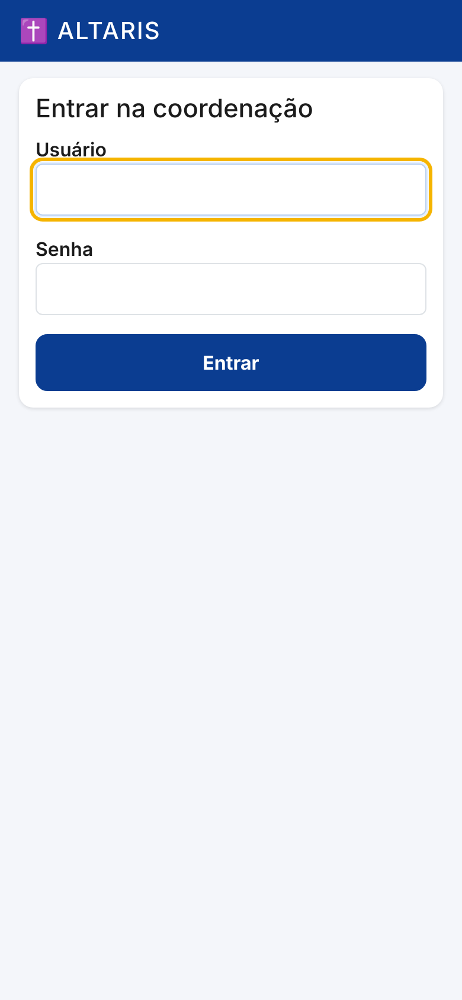 |  |
| 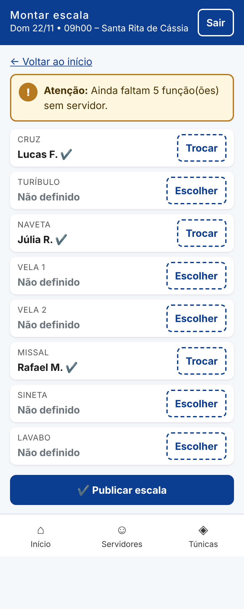 | 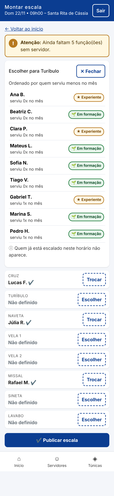 |
| 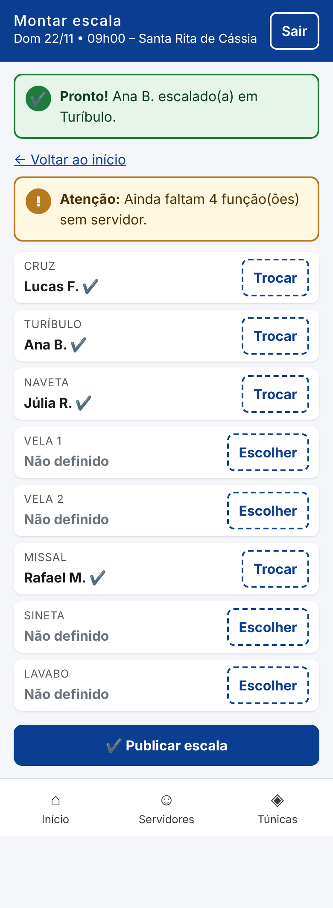 | 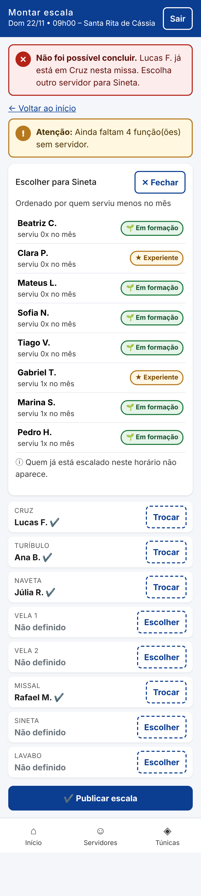 |
| 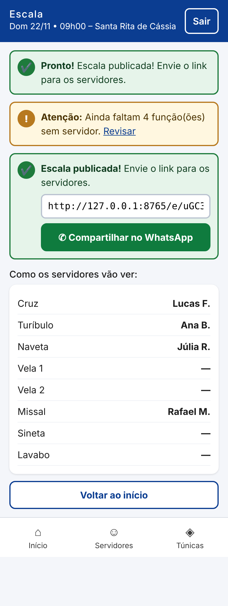 | 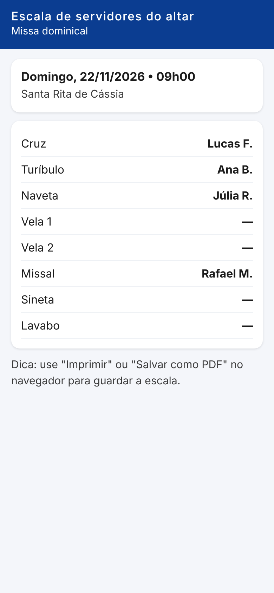 |
| 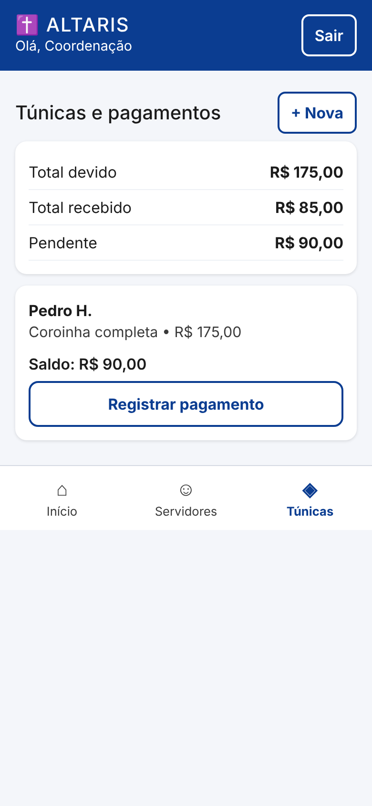 | 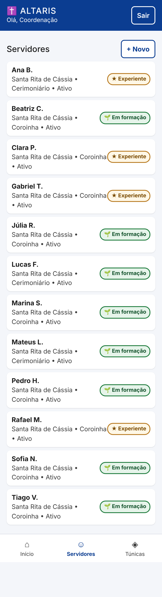 |
| 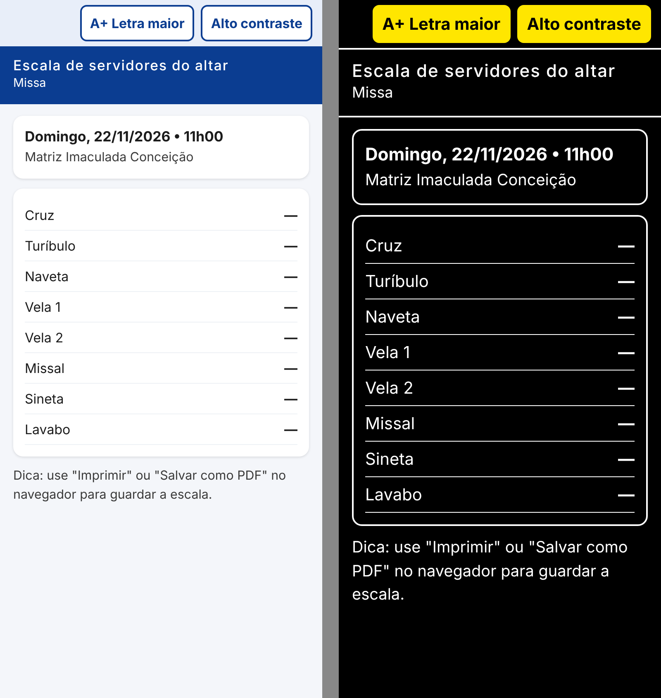 | 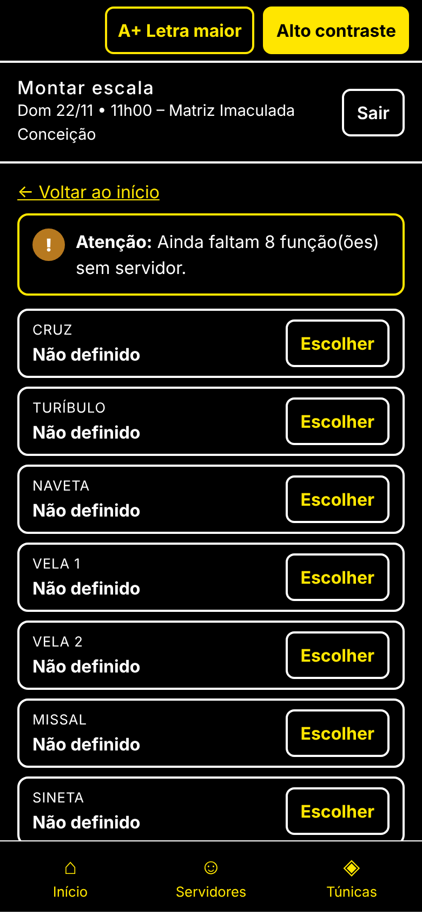 |

## Acessibilidade

- Botões **Letra maior** (125%) e **Alto contraste** (preto/amarelo) em todas as páginas, inclusive na escala pública enviada às famílias; a escolha fica salva no aparelho e o estado é anunciado a leitores de tela (`aria-pressed`).
- Atalho **Pular para o conteúdo**, foco visível em amarelo, alvos de toque com no mínimo 44 px.
- Alertas com ícone + texto (não dependem só da cor) e `role="alert"`.
